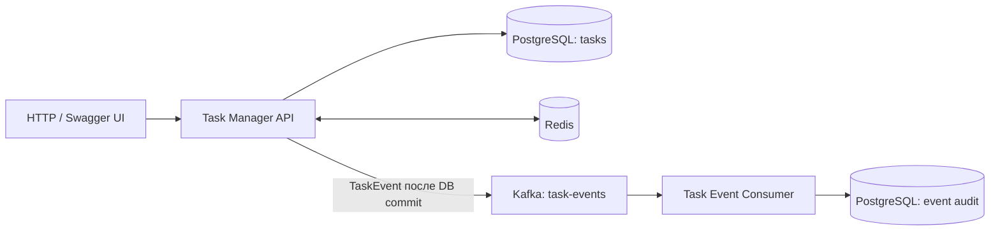

# Task Manager

[](https://github.com/KULICHx/task-manager/actions/workflows/ci.yml)
[](https://github.com/KULICHx/task-manager/actions/workflows/smoke.yml)

**Task Manager** — учебный backend-проект на Java 21 / Spring Boot 4 для управления пользователями, категориями и задачами. Включает REST API, кэширование Redis и асинхронную обработку событий через Apache Kafka.

Это два независимых Spring Boot-приложения: API обрабатывает запросы и публикует события, а consumer сохраняет историю изменений задач в отдельной PostgreSQL.

## Возможности

- CRUD для пользователей, категорий и задач; валидация DTO и единый формат типовых ошибок API.
- Поиск задач по названию, фильтрация по статусу, категории, типу и дате создания; постраничная выдача.
- Обработка типов задач с помощью Strategy: в частности, отдельные правила для `WORK`, `STUDY` и `URGENT`.
- Redis-кэш для получения задачи по ID с TTL 10 минут, инвалидацией при изменениях и синхронизацией операций кэша с транзакциями БД.
- Kafka-события `TASK_CREATED`, `TASK_UPDATED` и `TASK_DELETED`; отдельный consumer записывает их в PostgreSQL-аудит. Повторные события с одинаковым `eventId` не дублируют записи.
- Swagger UI, миграции Liquibase, Docker Compose, автотесты и GitHub Actions.

## Технологии

| Компонент | Технологии |
| --- | --- |
| Backend | Java 21, Spring Boot 4.0.3, Spring MVC, Bean Validation |
| Данные | PostgreSQL 16, Spring Data JPA / Hibernate, Spring JDBC, Liquibase |
| Кэш | Redis 7, Spring Cache |
| События | Apache Kafka, Spring for Apache Kafka |
| Документация API | OpenAPI 3 / Swagger UI |
| Тесты | JUnit 5, Mockito, Spring Boot Test, Testcontainers |
| Инфраструктура | Docker Compose, GitHub Actions |
| Мониторинг | Spring Boot Actuator, Micrometer; конфигурации Prometheus / Logstash находятся в `observability/` и не входят в базовый запуск |

## Архитектура



| Каталог | Назначение |
| --- | --- |
| `api/` | Контроллеры, сервисы, DTO, сущности, JPA, Redis, Kafka producer |
| `consumer/` | Kafka listener и запись истории изменений |
| `compose.yaml` | Две PostgreSQL, Kafka и Redis для локального запуска |
| `scripts/smoke-test.sh` | Проверка API → Kafka → Consumer и согласованности Redis |
| `docs/` | Инструкция локального запуска и технический аудит |
| `observability/` | Дополнительные конфигурации наблюдаемости |

Kafka-события отправляются после успешного коммита транзакции БД. Такой подход исключает отправку события для откатившейся транзакции, но **не гарантирует доставку** при недоступности брокера после коммита (см. «Ограничения»).

## Быстрый запуск на Windows

Понадобятся **JDK 21**, **Docker Desktop** (с Docker Compose v2) и Git. Maven устанавливать отдельно не нужно — используется Maven Wrapper.

```powershell
git clone https://github.com/KULICHx/task-manager.git
cd task-manager
Copy-Item .env.example .env
docker compose up -d
docker compose ps
```

Запустите API в первом PowerShell:

```powershell
cd api
.\mvnw.cmd spring-boot:run
```

Второй PowerShell откройте из корня репозитория и запустите consumer:

```powershell
cd consumer
.\mvnw.cmd spring-boot:run
```

После запуска доступен [Swagger UI](http://localhost:8081/swagger-ui.html), [OpenAPI JSON](http://localhost:8081/v3/api-docs) и [Actuator health](http://localhost:8081/actuator/health). Значения в `.env.example` предназначены только для локальной разработки.

[Подробная инструкция по запуску и проверке Kafka](docs/LOCAL_RUN.md)

## Примеры API

| Метод | Endpoint | Назначение |
| --- | --- | --- |
| `GET` / `POST` | `/api/users` | Список / создание пользователей |
| `GET` / `POST` | `/api/categories` | Список / создание категорий |
| `GET` / `POST` | `/api/tasks` | Список / создание задач |
| `GET` / `PUT` / `DELETE` | `/api/tasks/{id}` | Получение, обновление, удаление задачи |
| `GET` | `/api/tasks/paged?page=0&size=10` | Пагинация |
| `GET` | `/api/tasks/search?title=test` | Поиск по названию |
| `GET` | `/api/tasks/filter/status?completed=false` | Фильтрация по статусу |
| `GET` | `/api/tasks/by-type?type=WORK` | Фильтрация по типу |

Сначала нужно создать пользователя и категорию. Затем отправить `POST /api/tasks` с фактическими ID:

```json
{
  "title": "Подготовить API",
  "description": "Проверить создание задачи и Kafka-событие",
  "completed": false,
  "userId": 1,
  "categoryId": 1,
  "type": "WORK"
}
```

После создания, изменения или удаления задачи consumer записывает соответствующее событие в таблицу `task_event_audit`. Проверить её можно командой:

```powershell
docker compose exec audit-postgres psql -U task_events -d task_events_db -c "SELECT event_type, task_id, title, received_at FROM task_event_audit ORDER BY received_at;"
```

## Тестирование

```powershell
cd api
.\mvnw.cmd clean test
```

```powershell
cd consumer
.\mvnw.cmd clean test
```

При запуске интеграционных тестов API нужен работающий Docker Engine для Testcontainers.

**Проверено:** 33 теста API и 1 тест consumer прошли в [GitHub Actions](https://github.com/KULICHx/task-manager/actions/workflows/ci.yml). Отдельный [full-stack smoke test](https://github.com/KULICHx/task-manager/actions/workflows/smoke.yml) поднимает инфраструктуру, проверяет REST CRUD, события Kafka, запись аудита и актуализацию Redis-кэша. Базовый сценарий API → Kafka → Consumer → PostgreSQL также успешно воспроизведён вручную на Windows 8 ноября 2026 года (до последующих улучшений Redis и ошибок API).

## Ограничения и развитие

- Отправка Kafka после коммита не даёт гарантии доставки при отказе брокера; возможное развитие — transactional outbox и retry/DLQ.
- API пока не реализует аутентификацию: инфраструктура предназначена для **локального запуска**, а не публичного развёртывания.
- Крупные списки частично возвращаются без пагинации; конфигурации наблюдаемости требуют отдельной проверки.
- Для дальнейшего развития: расширение тестов на сбои Kafka, контракт событий, оптимизация запросов и регулярный статический анализ.

[Технический аудит и дальнейшие задачи](docs/AUDIT.md) · [Соглашения о коде и коммитах](CONTRIBUTING.md)
