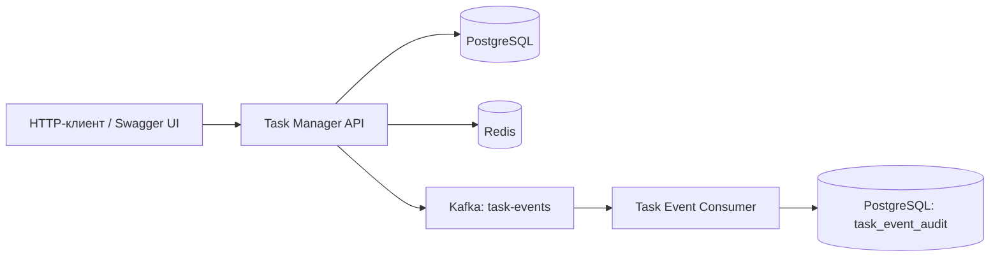

# Task Manager

REST API для управления пользователями, категориями и задачами на Java 21 и Spring Boot. Проект состоит из двух сервисов: основной API сохраняет данные в PostgreSQL и публикует события об изменениях задач в Kafka, а отдельный consumer обрабатывает эти события и сохраняет историю в свою базу данных.

> **Статус:** проект находится на этапе проверки запуска и интеграций. Исходный код, конфигурации и тесты опубликованы; успешная сборка, запуск инфраструктуры и сквозной сценарий ещё не подтверждены. См. [план аудита](docs/AUDIT.md).

## Технологии

| Область | Технологии |
| --- | --- |
| Язык и framework | Java 21, Spring Boot 4.0.3 |
| REST API | Spring MVC, Bean Validation, Swagger / OpenAPI |
| Хранение данных | PostgreSQL, Spring Data JPA, JDBC, Liquibase |
| Кэширование | Redis, Spring Cache |
| События | Apache Kafka, Spring for Apache Kafka |
| Инфраструктура | Docker Compose |
| Тестирование | JUnit, Spring Boot Test, Mockito, Testcontainers |
| Наблюдаемость | Spring Boot Actuator, Micrometer / Prometheus, Logback (конфигурация наблюдаемости пока не проверена) |

## Архитектура



- **`api/`** — CRUD для пользователей, категорий и задач; фильтрация, поиск, пагинация; публикация событий `TASK_CREATED`, `TASK_UPDATED`, `TASK_DELETED`.
- **`consumer/`** — отдельное приложение с Kafka listener и сохранением полученных событий в таблицу аудита. Повторное событие с тем же `eventId` не должно создавать вторую запись.
- **`compose.yaml`** — локальные PostgreSQL (для API и consumer), Redis и Kafka.
- **`docs/`** — аудит и инструкция запуска.
- **`observability/`** — экспериментальные конфигурации Prometheus и Logstash (не входят в базовый запуск).

Публикация событий в текущей реализации происходит **после коммита транзакции БД**. Это предотвращает отправку событий для откатившихся изменений, но **не гарантирует доставку**, если Kafka недоступна после коммита. Для более строгих гарантий требуется, например, transactional outbox.

## Возможности REST API

| Ресурс | Примеры операций |
| --- | --- |
| `/api/users` | `GET`, `POST`, `GET /{id}`, `PUT /{id}`, `DELETE /{id}` |
| `/api/categories` | Аналогичный CRUD категорий |
| `/api/tasks` | CRUD задач |
| `/api/tasks/paged` | Постраничный список |
| `/api/tasks/search?title=...` | Поиск по названию |
| `/api/tasks/by-type?type=WORK` | Фильтрация по типу |
| `/api/tasks/filter/status?completed=false` | Фильтрация по статусу |
| `/api/tasks/filter/date?from=...&to=...` | Фильтрация по дате |
| `/api/tasks/by-category/{categoryId}` | Задачи определённой категории |

Для создания задачи нужно сначала создать пользователя и категорию. Пример тела `POST /api/tasks`:

```json
{
  "title": "Подготовить тесты",
  "description": "Проверить API задач",
  "completed": false,
  "userId": 1,
  "categoryId": 1,
  "type": "WORK"
}
```

## Как запустить локально

Нужны **JDK 21**, **Docker Desktop с Compose v2** и доступ к интернету для первого скачивания зависимостей. Отдельно устанавливать Maven не нужно — в обоих сервисах есть Maven Wrapper.

В PowerShell из корня репозитория:

```powershell
Copy-Item .env.example .env
docker compose up -d
docker compose ps
```

Затем в **двух отдельных терминалах**, также из корня репозитория:

```powershell
cd api
.\mvnw.cmd spring-boot:run
```

```powershell
cd consumer
.\mvnw.cmd spring-boot:run
```

API настроен на **http://localhost:8081**. Предполагаемые адреса после запуска:
- Swagger UI: http://localhost:8081/swagger-ui.html
- OpenAPI: http://localhost:8081/v3/api-docs
- Health: http://localhost:8081/actuator/health

**Подробная инструкция и проверка Kafka:** [docs/LOCAL_RUN.md](docs/LOCAL_RUN.md). Настройки и пароли в `.env.example` предназначены исключительно для локальной разработки.

## Тесты

Из корня репозитория, при запущенном Docker Desktop (нужен для Testcontainers):

```powershell
cd api
.\mvnw.cmd clean test
```

```powershell
cd consumer
.\mvnw.cmd clean test
```

Тесты присутствуют в исходниках, но результаты их выполнения в текущем окружении **пока не подтверждены**. Следующий шаг — проверить сборку обоих модулей, миграции Liquibase и полный сценарий: создание / обновление / удаление задачи → Kafka → запись события consumer в PostgreSQL.

## Текущие ограничения и развитие

- Не подтверждён полный локальный запуск и end-to-end сценарий.
- Kafka `AFTER_COMMIT` не гарантирует доставку при сбое брокера.
- Требуется дополнительная проверка согласованности Redis-кэша и транзакций.
- Аутентификации пока нет; запуск предназначен для **локальной демонстрации**, а не публично доступного API.
- Автоматизация CI и полировка обработки ошибок — последующие этапы.

Текущий технический план: [docs/AUDIT.md](docs/AUDIT.md).
